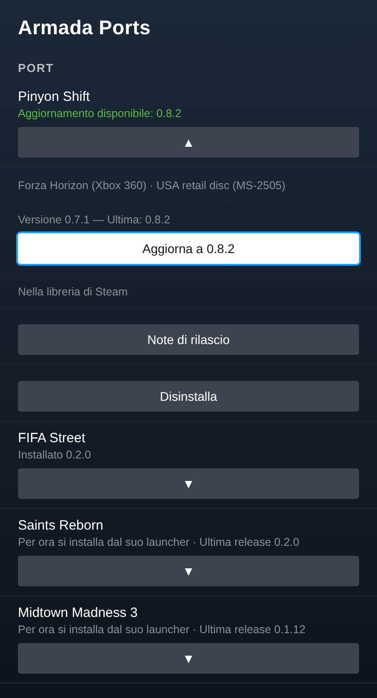
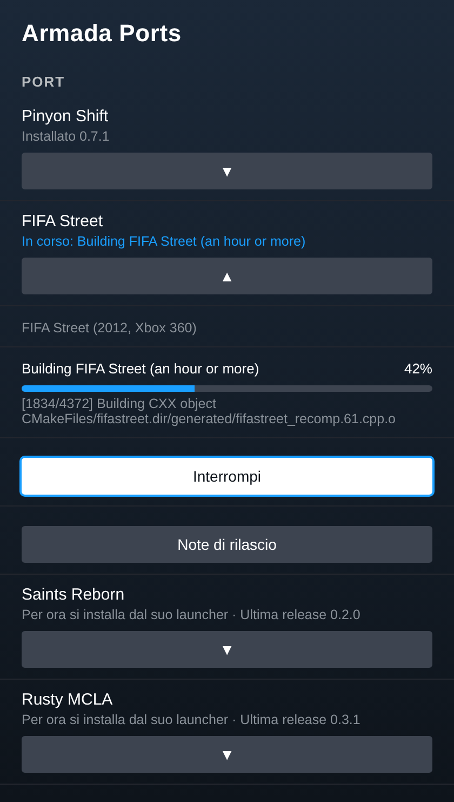

# Armada Ports

A [Decky Loader](https://github.com/SteamDeckHomebrew/decky-loader) plugin for
[ArmadaOS](https://github.com/armada-os/armada) that puts the ARM64 game ports in one list in
Game Mode. From the Quick Access menu you can install a port from your own disc image, follow one
you already installed with its launcher, get a notification when a new release is out, update it
and add it to Steam, without going to Desktop Mode.

The launchers keep working as before: the plugin is one more way to do the same job, not a
replacement.




## Ports

| Port | Game | From the plugin |
| --- | --- | --- |
| [Pinyon Shift](https://github.com/Ken5998/pinyon-shift-arm64) | Forza Horizon (Xbox 360) | install, update, Steam |
| [FIFA Street](https://github.com/Ken5998/fifa-street-arm64) | FIFA Street (2012, Xbox 360) | install, update, Steam |
| [Saints Reborn](https://github.com/Ken5998/saints-reborn-arm64) | Saints Row (Xbox 360) | new releases only, for now |
| [Midtown Madness 3](https://github.com/Ken5998/mm3-recomp-arm64) | Midtown Madness 3 (Xbox) | new releases only, for now |
| [Rusty MCLA](https://github.com/Ken5998/rusty-mcla-arm64) | Midnight Club: Los Angeles | new releases only, for now |
| [Road Trip Adventure](https://github.com/Ken5998/road-trip-arm64) | Road Trip Adventure (PS2) | new releases only, for now |
| [ReSkate](https://github.com/Ken5998/reskate-arm64) | skate. (Steam) | new releases only, for now |
| [Azimuth Turnip](https://github.com/Ken5998/azimuth-arm64) | Forza Horizon 2 driver | new releases only, for now |

"New releases only" means the plugin shows the newest release and its notes; install and update
those with their launcher or README until they get their own support here.

You bring the disc images. The plugin downloads nothing but the launchers and the ports' public
scripts, and the game is built on the handheld from your copy.

## Install

Needs Decky Loader (ArmadaOS ships it; the prerelease channel is fine).

1. In Desktop Mode, download `ArmadaPorts-vX.Y.Z.zip` and `install.sh` from the
   [latest release](https://github.com/Ken5998/armada-ports/releases/latest) into the same folder.
2. Open a terminal there and run `bash install.sh`. It checks the ZIP, asks for your password
   (Decky's plugin folder belongs to root) and restarts Decky.
3. Back in Game Mode, open the Quick Access menu (`…`), then the plug icon, then **Armada Ports**.

Later versions update from the plugin itself: a button appears at the bottom of the panel.

## Use

Pick a port in the list to open it.

- **Install** asks for your disc image with Decky's file picker, tells you roughly how long the
  build takes, then starts it. Keep the charger plugged in. You can close the menu and even play
  something else: the build runs as its own service, and a notification tells you when it is done.
  The game is then added to Steam (no Steam restart needed).
- **It is already installed** looks for an install made with the launcher in its usual place. If it
  is somewhere else, pick the folder you unpacked the launcher in.
- **Update to …** shows up when a new release (or, for FIFA Street, new scripts on main) is out. It
  replaces the launcher with the new one and rebuilds from the game files already extracted, so the
  disc image is only needed again if those are gone.
- **Add to Steam** adds the game as a non-Steam shortcut. Artwork is up to you (SteamGridDB).
- **Uninstall** deletes the build, its extracted game files, its saves and its Steam shortcut. Your disc image, and a
  launcher folder you picked yourself, stay.

The plugin looks for new releases a little after Game Mode starts and then every six hours.
**Check for updates** looks right away.

## How it works

Each port the plugin installs has a small adapter in `py_modules/armadaports.py` that does what the
port's launcher does, with the same files in the same places, so the launcher and the plugin can be
used on the same install:

- **Pinyon Shift**: unpacks the release's source payload into
  `~/.local/share/PinyonShift/source/<version>` as the launcher does, then runs
  `tools/pinyon.py setup` (with `--iso` the first time, `--build-only` after an update) and
  `tools/pinyon.py shortcuts add` for the start script.
- **FIFA Street**: keeps the repository clone in `~/.local/share/FifaStreet-arm64/overlay` up to
  date and runs `scripts/build.sh` with the disc image or `-`.

Launchers the plugin downloads go to `~/.local/share/armada-ports/launchers/<port>`, or replace the
one in the folder you picked. A build runs with `systemd-run --user` and writes its progress to
`~/.local/share/armada-ports/jobs/<port>.json`; its full output is in
`~/.local/share/armada-ports/logs/`.

`ports.json` lists the ports. Supporting a new one is an entry there plus an adapter.

## Troubleshooting

- A build failed: the panel shows the error and the log's path. The log ends with the command that
  failed.
- Plugin errors after an ArmadaOS or Steam update: update Decky (prerelease channel) first. Decky's
  own log: `journalctl -u plugin_loader -b`.
- A build seems stuck: `systemctl --user list-units 'armada-ports-*'` shows it, and
  `tail -f ~/.local/share/armada-ports/logs/<newest>.log` what it is doing.

## Remove

In Decky's settings, uninstall Armada Ports. The games stay; `~/.local/share/armada-ports` holds the
plugin's own launchers, logs and state and can be deleted.

## Build

```bash
pnpm install --frozen-lockfile
pnpm build
python3 -m unittest discover -s tests
bash scripts/package.sh    # out/ArmadaPorts-vX.Y.Z.zip
```

## License

MIT, see [LICENSE](LICENSE). The ports, launchers and games have their own licenses.
