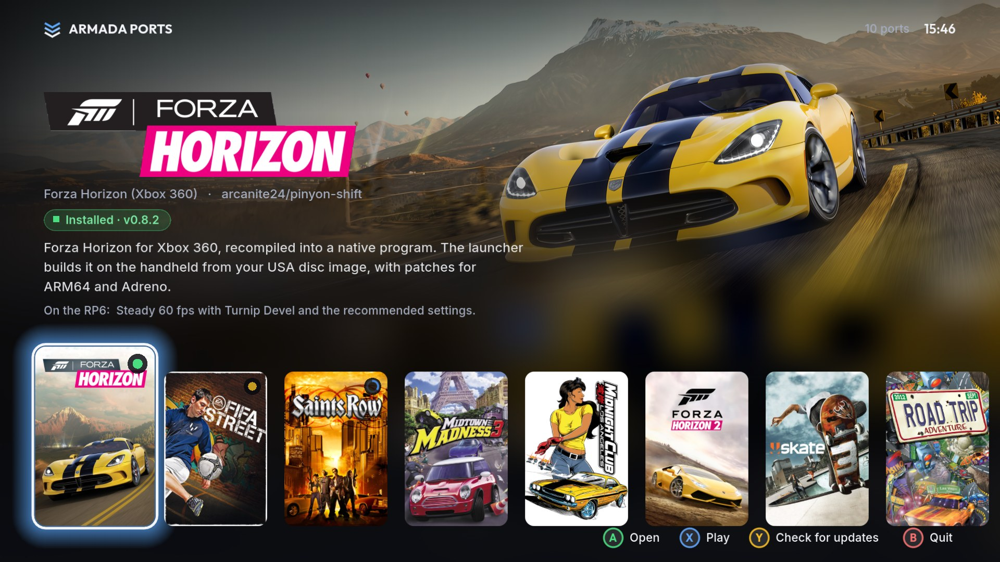
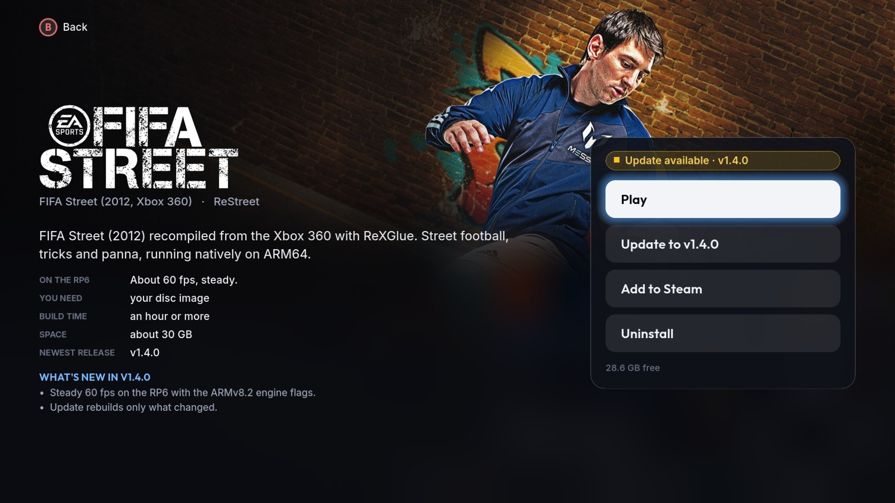
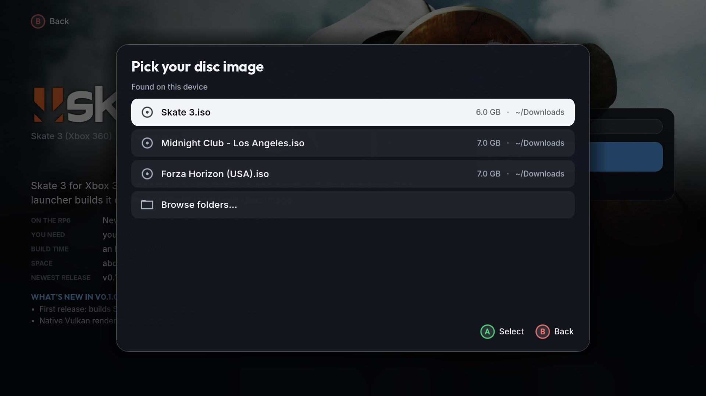
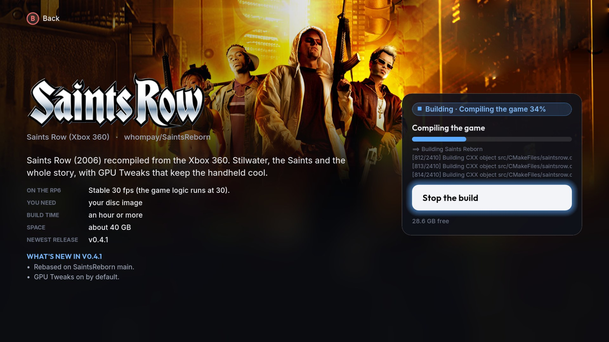
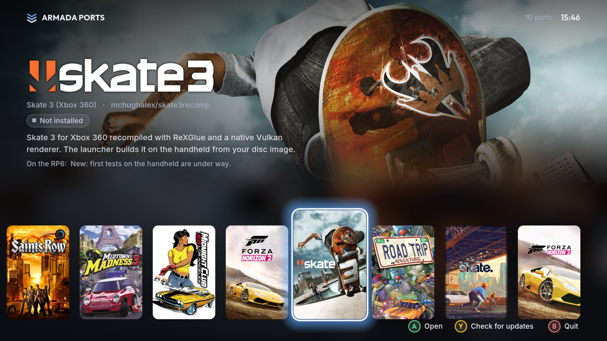

# Armada Ports

The ARM64 game ports for [ArmadaOS](https://github.com/armada-os/armada) in one app made for Game
Mode. **Armada Ports** sits in your Steam library like a game: open it, flip through the ports with
the controller, read what each one is and how it runs on the Retroid Pocket 6, then install it from
your own disc image, update it and play it, without going to Desktop Mode.



| | |
| --- | --- |
|  |  |
|  |  |

## Ports

| Port | Game | From the app |
| --- | --- | --- |
| [Pinyon Shift](https://github.com/Ken5998/pinyon-shift-arm64) | Forza Horizon (Xbox 360) | install, update, play |
| [FIFA Street](https://github.com/Ken5998/fifa-street-arm64) | FIFA Street (2012, Xbox 360) | install, update, play |
| [Saints Reborn](https://github.com/Ken5998/saints-reborn-arm64) | Saints Row (Xbox 360) | install, update, play |
| [Midtown Madness 3](https://github.com/Ken5998/mm3-recomp-arm64) | Midtown Madness 3 (Xbox) | install, update, play |
| [Rusty MCLA](https://github.com/Ken5998/rusty-mcla-arm64) | Midnight Club: Los Angeles | install, update, play |
| [FH2 Recompiled](https://github.com/Ken5998/fh2-recompiled-arm64) | Forza Horizon 2 (Xbox 360) | install, update, play |
| [Skate 3 Recomp](https://github.com/Ken5998/skate3-recomp-arm64) | Skate 3 (Xbox 360) | install, update, play |
| [Road Trip Adventure](https://github.com/Ken5998/road-trip-arm64) | Road Trip Adventure (PS2) | newest release, for now |
| [ReSkate](https://github.com/Ken5998/reskate-arm64) | skate. (Steam) | newest release, for now |
| [Azimuth Turnip](https://github.com/Ken5998/azimuth-arm64) | Forza Horizon 2 driver | newest release, for now |

You bring the disc images. Nothing of the games is downloaded: each port is built on the handheld
from your copy. The covers, backgrounds and logos come from [SteamGridDB](https://www.steamgriddb.com)
(the community's artwork): the app downloads them the first time it shows a port and keeps them.

## Install

Needs Decky Loader, which ArmadaOS ships. One download holds both halves: the app, and a small Decky
plugin that puts it (and the games it builds) in your Steam library at once, artwork included,
without restarting Steam.

1. In Desktop Mode, download `ArmadaPorts-vX.Y.Z.zip` and `install.sh` from the
   [latest release](https://github.com/Ken5998/armada-ports/releases/latest) into the same folder.
2. Open a terminal there and run `bash install.sh`. It checks the ZIP, asks for your password
   (Decky's plugin folder belongs to root) and restarts Decky.
3. Back in Game Mode, **Armada Ports** shows up in your library after a few seconds. Open it like
   any game.

Already on 0.2.x? Update from the Quick Access menu as before (Decky, Armada Ports, **Update
Armada Ports**); the app then appears in your library on its own.

## Use

| Button | Home | A port's page |
| --- | --- | --- |
| D-pad / left stick | move along the covers | move between the buttons |
| A | open the port | press the button |
| X | play it (when it is built) | play it |
| Y | check for new releases | |
| B | quit | back |
| L1 / R1 | jump four covers | |

The touchscreen works too: tap a cover to pick it, tap it again to open it, drag the row.

- **Install** finds the disc images in your home folder, Downloads, Games and on the SD card and
  lists them; **Browse folders** if yours is elsewhere. It then tells you how long the build takes
  and starts it. The build runs as its own service, so you can leave the app and play something else;
  keep the charger plugged in. A notification tells you when it is done, and the game is added to
  your Steam library.
- **Play** starts the game in the app's place, with the screen, the controller and the memory all
  for the game; when you quit the game you are back on its page. If the game is in your Steam
  library too, it starts with the Turnip driver and performance profile you set for **it** in Armada
  Control.
- **Update to …** shows up when a new release is out. It brings the new launcher and rebuilds from
  the game files already extracted, so the disc image is only asked for again if those are gone.
- **Add to Steam** puts the game in your library with its artwork, through the plugin.
- **Uninstall** deletes the build, its extracted game files, its saves and its Steam shortcut. Your
  disc image stays.

The app looks for new releases when it starts (at most every six hours); **Y** looks right away.
The Quick Access menu's Armada Ports panel opens the app, shows running builds and new releases,
and updates Armada Ports itself.

## How it works

- **The app** (`app/`) is a [Godot 4.7](https://godotengine.org) project exported for linux-arm64:
  one program, about 70 MB, that runs full screen under gamescope with the GL compatibility
  renderer. It is installed to `~/.local/share/armada-ports/app`, and its Steam shortcut starts
  `armada-ports.sh`, which also starts the games the app hands over (see the script).
- **The backend** is `py_modules/armadaports.py`, the same code the plugin had: each port has an
  adapter that does what its launcher does, with the same files in the same places, so a launcher
  and the app can be used on the same install. The app runs it as
  `python3 armadaports.py cli COMMAND` and reads one JSON answer. Builds run with
  `systemd-run --user`, write their progress to `~/.local/share/armada-ports/jobs/<port>.json` and
  their output to `~/.local/share/armada-ports/logs/`.
- **The plugin** (`main.py`, `src/`) copies the app into place when it loads, answers the app's
  requests (`~/.local/share/armada-ports/bridge`) by adding or removing shortcuts with Steam's own
  `SteamClient.Apps`, and keeps the update notifications.
- **The catalog** is `ports.json`: per port its repository, adapter, texts in English and Italian,
  and the SteamGridDB image links. `scripts/pick-artwork.py` picks the best-rated images for a
  port's SteamGridDB id; replace any link by hand to use another image.

## Troubleshooting

- A build failed: its page shows the error and the last lines of the log; the whole log is in
  `~/.local/share/armada-ports/logs/`.
- The app itself: `~/.local/share/armada-ports/app.log` has its output and every game it started.
- **Add to Steam** says the plugin is not answering: Decky is not running or the plugin is off.
  After an ArmadaOS or Steam update, update Decky (prerelease channel) first. Decky's log:
  `journalctl -u plugin_loader -b`.
- A build seems stuck: `systemctl --user list-units 'armada-ports-*'` shows it, and
  `tail -f ~/.local/share/armada-ports/logs/<newest>.log` what it is doing.

## Remove

Uninstall Armada Ports in Decky's settings and remove its shortcut from your library. The games
stay; `~/.local/share/armada-ports` holds the app, logs, artwork and state and can be deleted.

## Build

```bash
python3 -m unittest discover -s tests
bash scripts/build-app.sh     # downloads Godot once, exports out/app/armada-ports (arm64)
bash scripts/check-app.sh     # runs every screen once without a display
pnpm install --frozen-lockfile && pnpm build
bash scripts/package.sh       # out/ArmadaPorts-vX.Y.Z.zip
```

To try the app on a PC: `python3 scripts/demo-home.py /tmp/demo` makes a pretend home with a few
ports installed and a build running, then run the Godot editor on `app/` with `HOME=/tmp/demo` and
`ARMADA_PORTS_BACKEND` set to a folder holding `armadaports.py` and `ports.json`.

## License

MIT, see [LICENSE](LICENSE). The fonts (Outfit, Inter) are under the SIL Open Font License, see
[app/fonts/OFL.txt](app/fonts/OFL.txt). The ports, launchers and games have their own licenses;
the artwork belongs to its authors on SteamGridDB and is not part of this repository.
